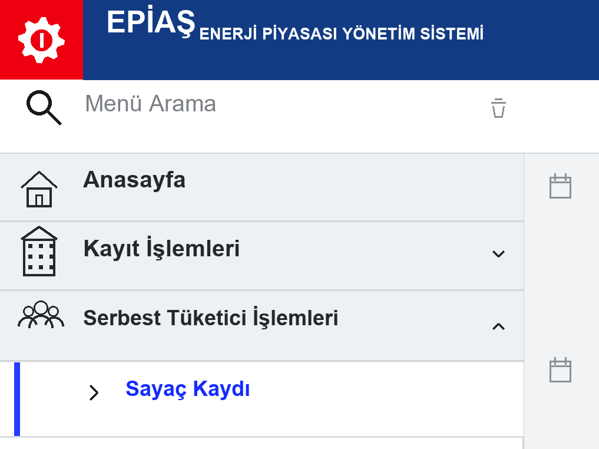

# SKF Yerel Uygulama Kullanım Kılavuzu

**Windows paketi v1.3.6 · İlk kez kullananlar için adım adım anlatım**

Bu kılavuz, uygulamayı internetten indirme aşamasından Excel sonucunu kaydetmeye kadar anlatır. Bilgisayara Python kurmanız gerekmez ve komut yazmanız istenmez.

> **Güvenli kullanım:** Web sayfası Windows uygulamasını indirmek içindir. Gizli fatura veya müşteri dosyalarını web sayfasına yüklemeyin. İndirilen Windows paketinde dosyalar bilgisayarınızdan seçilir ve bilgisayarınızda işlenir.

## En kısa kullanım akışı

1. Uygulama sayfasından Windows paketini indirin.
2. ZIP dosyasını bir klasöre ayıklayın.
3. Klasördeki **SKF'yi Başlat.vbs** dosyasına çift tıklayın.
4. Dağıtım klasörünü ve **Bizim Kestiğimiz Faturalar** dosyasını seçin.
5. **Verileri Birleştir ve Karşılaştır** düğmesine basıp Excel sonucunu indirin.

## 1. Başlamadan önce

Uygulama, dağıtım şirketlerinden gelen SKF verilerini ve şirketinizin **Bizim Kestiğimiz Faturalar** verisini bir araya getirip karşılaştırır. Sonuçları Excel dosyası olarak hazırlar. İsterseniz Uzlaştırma Tüketim ve Kesin Liste dosyalarını da kullanabilirsiniz.

Uygulamayı çalıştırmak için Windows 64 bit bilgisayar gerekir. Python, yönetici izni veya Excel programı kurulumu gerekmez. Uygulama indirildikten sonra çalışmak için internet bağlantısına ihtiyaç duymaz. İndirilen Excel sonucunu açmak için bilgisayarınızda Excel veya uyumlu bir tablo programı bulunmalıdır.

### Hangi dosyalar gerekli?

- **Tam karşılaştırma için gerekli:** Dağıtım bölgelerinin klasörlerini içeren ana klasör ve ilgili döneme ait **Bizim Kestiğimiz Faturalar** Excel dosyası.
- **İsteğe bağlı:** **Uzlaştırma Tüketim** Excel dosyası. Tüketim karşılaştırmasını ekler. Her yeni analizde yeniden seçilir.
- **İsteğe bağlı:** **Kesin Liste** Excel dosyası. Sayaç ve müşteri eşleşmelerini tamamlamaya yardımcı olur. Seçilmezse uygulama dağıtım klasörünün içinde arar.
- **Sistem Kullanım Bedelleri:** Uygulama paketinde varsayılan bir dosya bulunur. Ekran uyarı vermiyorsa değiştirmeniz gerekmez.

Excel kaynak dosyaları **.xlsx**, **.xlsm** veya **.xls** biçiminde olmalıdır. Dağıtım klasörünün içinde tek tek şirket veya bölge klasörleri bulunmalıdır; bu klasörlerin içindeki dosyalar uygulama tarafından taranır.

## 2. Windows paketini indirme

1. Tarayıcıda [SKF uygulama sayfasını](https://ckenerji-skf.streamlit.app/) açın.
2. **Windows uygulamasını indir** başlığının altındaki **Yerel paketi indir** düğmesine basın.
3. İnen dosyanın adı **SKF-Yerel-Paket-1.3.6.zip** olmalıdır. Tarayıcı dosyayı genellikle **İndirilenler** klasörüne kaydeder.

Sayfada daha yeni bir sürüm numarası görünüyorsa yeni sürümü indirin. Uygulama sayfası açılmazsa [GitHub'daki v1.3.6 Windows paketini](https://github.com/senanurmocan/SKF/releases/download/v1.3.6/SKF-Yerel-Paket-1.3.6.zip) kullanabilirsiniz.

**ZIP**, dosyaları sıkıştırılmış halde bir arada tutan bir pakettir. İçindeki programı çalıştırmadan önce paketi normal klasöre çıkarmanız gerekir.

## 3. ZIP dosyasını klasöre çıkarma

Bu adımlarda ZIP dosyası **İndirilenler** klasöründe kalır; çalıştıracağınız uygulama dosyaları ise **Masaüstü**ne çıkarılır.

1<strong>ZIP'e sağ tıklayın</strong><small>İndirilenler klasöründeki SKF-Yerel-Paket-1.3.6.zip</small>
›
2<strong>Tümünü ayıkla</strong><small>Açılan menüde bu seçeneğe basın</small>
›
3<strong>Gözat > Masaüstü</strong><small>SKF-Yerel klasörünü seçin</small>
›
4<strong>Klasörü Seç > Ayıkla</strong><small>Dosyalar Masaüstü'ne çıkarılır</small>

1. Klavyede **Windows tuşu + R** tuşlarına birlikte basın.
2. Açılan küçük kutuya **shell:desktop** yazıp **Enter** tuşuna basın. Masaüstü klasörü açılır.
3. Klasörün boş bir yerine sağ tıklayın. **Yeni > Klasör** seçeneklerini seçin ve yeni klasöre **SKF-Yerel** adını verin.
4. **İndirilenler** klasörünü açın. **SKF-Yerel-Paket-1.3.6.zip** dosyasına sağ tıklayıp **Tümünü ayıkla** seçeneğine basın.
5. Açılan pencerede **Gözat** düğmesine basın. Soldaki listeden **Masaüstü**nü, ardından **SKF-Yerel** klasörünü seçin. **Klasörü Seç** düğmesine basarak bu konumu onaylayın.
6. Ayıklama penceresine dönünce hedef konumun **Masaüstü\SKF-Yerel** olduğunu kontrol edin ve **Ayıkla** düğmesine basın.
7. Ayıklama bitince Masaüstü'ndeki **SKF-Yerel** klasörünü açın. İçinde **SKF-Yerel-Paket-1.3.6** adlı klasörü göreceksiniz. Bir sonraki bölümde uygulamayı bu klasörden başlatacaksınız.

Bilgisayarınız Masaüstü'ne kaydetmenize izin vermiyorsa yazma izniniz bulunan başka bir konum seçin. Paketin içindeki dosyaları ayrı ayrı taşımayın veya silmeyin.

## 4. Uygulamayı açma

1. **SKF-Yerel-Paket-1.3.6** klasörünü açın.
2. **SKF'yi Başlat.vbs** dosyasına çift tıklayın.
3. Windows güvenlik uyarısı gösterebilir. Dosya adının **SKF'yi Başlat.vbs** olduğunu ve paketi güvenilir uygulama sayfasından indirdiğinizi doğrulayın. Kaynak doğru değilse çalıştırmayın.
4. Uygulama arka planda başlar ve hazır olduğunda Windows'un varsayılan tarayıcısında açılır. Tarayıcı açılamazsa Windows uyarısında yerel adres gösterilir. Siyah komut penceresi açılmaz; e-posta veya kullanıcı girişi istenmez.
5. Uygulamayı durdurmak için paket klasöründeki **SKF'yi Kapat.vbs** dosyasına çift tıklayın.

Adres çubuğunda **ckenerji-skf.streamlit.app** görünüyorsa yerel uygulamada değilsiniz; bu uygulamayı indirme sayfasıdır.

## 5. Uygulamada dosyaları seçme

Uygulamanın sol tarafındaki **Veri Kaynağı** bölümünde dosya ve klasör seçme düğmeleri bulunur. Her düğmeye bastığınızda Windows'un dosya seçme penceresi açılır.

### Önce dağıtım ana klasörünü seçin

İşleyeceğiniz aya ait bütün dağıtım şirketlerinin SKF dosyalarını tek bir ana klasörde toplayın. Ana klasörün içine her dağıtım şirketi için ayrı bir alt klasör açın; bu alt klasöre şirketin adını verin ve o şirkete ait dosyaları içine kaydedin.

1. **Dağıtım Şirketi SKF** düğmesine basın.
2. İlgili aya ait ve şirket adlarıyla oluşturulmuş bütün alt klasörleri doğrudan içinde bulunduran ana klasöre gidin.
3. Ana klasörü seçip **Klasör Seç** düğmesine basın.

Uygulamada seçmeniz gereken klasör, o aya ait bütün dağıtım şirketlerinin adlandırılmış alt klasörlerini birlikte içeren ana klasördür. Tek bir şirket klasörünü veya ZIP dosyasını seçmeyin. Uygulama 21 dağıtım şirketi/bölge klasörü bekler; ekranda sayı daha az görünürse eksik şirket klasörlerini ekleyin veya ana klasörü doğru seçtiğinizi kontrol edin. Şirket klasörü adları büyük/küçük harfe duyarsız eşleştirilir; örneğin **AKEDAŞ** ve **akedaş** aynı bölge olarak tanınır.

### Bizim Kestiğimiz Faturalar dosyasını seçin

Önceki sayfadaki iki ekran görüntüsü aşağıdaki rapor yolunu gösterir. Bu adımları izleyerek ilgili aya ait **İcmal Detayı** Excel dosyasını sistemden alın; ardından bu alana yükleyin.

1. Üst menüde **Kumanda Tabloları**nı açıp **CK Operasyon Raporları**nı seçin.
2. **Faturalama** sekmesine tıklayın.
3. **Tahakkuk İcmal Raporu (42105)** raporunu seçin.
4. Raporda **Detay** sekmesine geçin ve **Dönem** alanından işlem yapacağınız ayı seçin. Dönem **YYYYMM** biçimindedir; örneğin **202611**.
5. Bilgi istemi veya filtre penceresi açılırsa gerekli değerleri seçip **Devam Et** düğmesine basın. Raporun açılması birkaç dakika sürebilir.
6. Sistemden aldığınız ilgili aya ait **İcmal Detayı** Excel dosyasını bilgisayarınıza kaydedin. Bir sonraki adımda bu dosyayı uygulamaya seçeceksiniz.

1. **Bizim Kestiğimiz Faturalar** düğmesine basın.
2. Az önce sistemden kaydettiğiniz, işlemek istediğiniz döneme ait **İcmal Detayı** Excel dosyasını seçin.
3. **Aç** düğmesine basın.

Analiz düğmesi, gerekli klasör ve dosya seçilene kadar soluk görünebilir. Dosya adlarını ve dönemlerini seçmeden önce kontrol edin.

### İsteğe bağlı dosyaları ekleyin

- **Uzlaştırma Tüketim:** EPIAŞ’tan işlem yapacağınız aya ait Uzlaştırma Tüketim Excel dosyasını indirin ve bu alandaki düğmeden seçin. Analizi başlattığınızda ETSO bazlı tüketim karşılaştırmasına eklenir. Dosyayı her yeni analizde yeniden seçin.
- **GES Üretimi (isteğe bağlı):** Tedarikçi LUM bildirimi biçimindeki `.xlsx` dosyasını **GES Üretimi** düğmesine basarak seçin. Bu dosya, dağıtım ile uzlaştırma arasındaki farkın GES üretimiyle ilişkili olup olmadığını değerlendirebilmeniz için karşılaştırmaya eklenir. Üretim miktarları ETSO koduna göre eşleştirilir; GES dosyasında bulunmayan ETSO'lar sıfır gösterilir.
- **Kesin Liste (isteğe bağlı):** EPİAŞ'ta **Serbest Tüketici İşlemleri > Sayaç Kaydı** yolunu izleyip işlem dönemine ait Kesin Liste Excel dosyasını indirin. Dosyayı bu alandaki düğmeden yükleyebilir veya dağıtım SKF ana klasörünün içine ya da alt klasörlerinden birine bırakabilirsiniz. Uygulama ana klasörü ve alt klasörleri otomatik arar. Dosya seçimi uygulama kapatılıp açıldığında hatırlanmaz.

   Sayaç Kaydı" width="520">

### Sistem Kullanım Bedelleri dosyasını kontrol edin

Uygulamanın ana bölümünde **Sistem Kullanım Bedelleri** alanı bulunur. Yanında seçim işareti varsa paket içindeki dosya kullanılabilir durumdadır. Dosyanın bulunamadığını belirten uyarı görürseniz yanındaki **₺** düğmesine basıp kurumunuzun kullanmanız için verdiği Excel dosyasını seçin.

## 6. Yapacağınız işlemi seçme

### Dağıtım verileriyle tam karşılaştırma

**Yalnızca Bizim Kestiğimiz Faturalar** kutusunu işaretlemeyin. Dağıtım ana klasörünü ve **Bizim Kestiğimiz Faturalar** dosyasını seçin. Düğmenin adı **Verileri Birleştir ve Karşılaştır** olur.

### Sadece fatura verisini hazırlama

Dağıtım faturalarıyla karşılaştırma yapmadan yalnızca kendi fatura dosyanızı işlemek istiyorsanız **Yalnızca Bizim Kestiğimiz Faturalar** kutusunu işaretleyin. Dağıtım klasörü bu işlemde kullanılmaz. Düğmenin adı **Yalnızca Fatura Verisini Hazırla** olur.

### Yalnızca dağıtım SKF'sini hazırlama

Dağıtım ana klasörünü seçin ve **Yalnızca Dağıtım SKF'si** kutusunu işaretleyin. Fatura dosyası seçmeniz gerekmez. **Yalnızca Dağıtım SKF'sini Hazırla** düğmesine basın. Analiz tamamlanınca **Birleştirilmiş Dağıtım SKF Dosyasını İndir** düğmesinden 21 bölgedeki dağıtım kayıtlarının birleştirilmiş ve düzenlenmiş Excel dosyasını indirin. Eksik bölge varsa uygulama uyarı gösterir.

## 7. Analizi çalıştırma ve sonucu indirme

1. Seçtiğiniz klasör ve Excel dosyalarının doğru olduğunu kontrol edin.
2. Tam karşılaştırma için **Verileri Birleştir ve Karşılaştır** düğmesine basın. Sadece fatura modu seçiliyse **Yalnızca Fatura Verisini Hazırla** düğmesine basın.
3. İşlem sürerken uygulama sekmesini kapatmayın. Dosya sayısı ve bilgisayarın hızına göre işlem biraz zaman alabilir.
4. **Analiz tamamlandı** mesajını gördüğünüzde sonuç bölümüne inin.
5. Tam karşılaştırmanın Excel dosyası için **SKF Dosyasını İndir** düğmesine basın. Sadece fatura modunda **Bizim Kestiğimiz dosyasını indir** düğmesine basın.
6. Tarayıcı indirmenin tamamlandığını gösterince dosyayı açın. Dosya çoğunlukla **İndirilenler** klasörüne kaydedilir.

Sonuç, kaynak dosyaların üzerine yazılmaz; ayrı bir Excel dosyası olarak indirilir. Uzlaştırma Tüketim seçtiyseniz ilgili ek karşılaştırma raporları da ekranda sunulabilir. Belirli dağıtım şirketleri için ayrı rapor almak isterseniz şirketleri seçip **Seçilen Şirketler İçin Rapor Oluştur** düğmesine basın.

### ETSO bazlı tüketim karşılaştırması

Uzlaştırma Tüketim ve GES üretimi dosyalarını seçtiyseniz sonuç bölümündeki **ETSO Bazlı Tüketim Karşılaştırmasını İndir** düğmesiyle tek Excel raporu indirin. Raporda tüm ETSO'lar ve müşteri adlarıyla birlikte bizim kestiğimiz, dağıtımın ilettiği, uzlaştırma ve GES tüketim/üretim miktarları bulunur. GES sütunu, dağıtım ile uzlaştırma farkının GES üretimiyle ilişkili olup olmadığını ETSO bazında incelemenizi sağlar. Fark sütunu Excel formülüyle yalnızca **Dağıtım − Uzlaştırma** olarak hesaplanır; başka bir fark gösterilmez. Farkı olmayan ETSO'lar da raporda kalır. Sayısal değerler virgüllü biçimde ve düzenlenebilir olarak saklanır; GES üretimi bulunmayan ETSO'larda değer **0** olur. Renkler yalnızca fark sütununu belirtir.

SKF ve tüketim karşılaştırması çıktılarında **Kesin** ve **Taslak** kayıtlar birlikte yer alır; durumlarına göre ayırma yapılmaz. Tam karşılaştırmada **Diğer Bedel Tablosu** çıktısı SKF önizlemesinin altında, **Ek Kalem Bedel Farklarını İndir** düğmesiyle alınır.

Ekrandaki önizlemede bazı kodlar gizlenmiş görünebilir. İndirilen Excel dosyasında kaynak dosyadaki kodlar korunur.

## 8. Uygulamayı kapatma ve yeniden açma

İndirme tamamlandıktan sonra tarayıcı sekmesini kapatın. Ardından **SKF'yi Kapat.vbs** dosyasına çift tıklayın. Yalnızca tarayıcı sekmesini kapatmak uygulamayı durdurmaz.

Başka bir gün yeniden kullanmak için ayıklanmış klasörü silmeyin. **SKF'yi Başlat.vbs** dosyasına yeniden çift tıklayın. Yeni oturumda dağıtım klasörünü ve fatura dosyasını tekrar seçin. Uzlaştırma Tüketim ve Kesin Liste seçimleri oturum kapanınca hatırlanmaz.

Yeni sürüme geçerken önce **SKF'yi Kapat.vbs** ile çalışan uygulamayı durdurun. Yeni paketi ayrı bir klasöre çıkarmanız, eski ve yeni sürümün karışmasını önler.

## 9. Sık karşılaşılan durumlar

- **Uygulama başlatılamadı:** Hata oluşursa ayrıntı Windows uyarı penceresinde görünür. Ekran görüntüsünü kurum BT veya destek ekibine iletin; fatura ya da müşteri dosyalarını göndermeyin.
- **Tarayıcı açılmadı:** Windows uyarısında gösterilen `localhost` adresini varsayılan tarayıcınızda açın. Uyarı yoksa **SKF'yi Başlat.vbs** dosyasına yeniden çift tıklayın. Sorun sürerse BT veya destek ekibinizden yardım alın.
- **Analiz düğmesi soluk:** Tam karşılaştırma için dağıtım ana klasörünü ve **Bizim Kestiğimiz Faturalar** dosyasını seçin. Sadece fatura verisi hazırlayacaksanız ilgili kutuyu işaretleyin.
- **21'den az bölge bulundu:** Dağıtım bölgelerinin alt klasörlerini içinde tutan ana klasörü seçtiğinizden emin olun.
- **Dosya bulunamadı uyarısı:** Dosya taşınmış veya adı değişmiş olabilir. Dosya seçme düğmesiyle geçerli dosyayı yeniden seçin.
- **İşlem tamamlanamadı:** Doğru döneme ait dosyaları seçtiğinizi ve dosya biçiminin Excel olduğunu kontrol edin. Sorun sürerse hata mesajının ekran görüntüsünü kurum destek ekibine iletin; fatura veya müşteri dosyasını göndermeyin.
- **Yayıncı doğrulanamadı uyarısı:** Dosya adının **SKF'yi Başlat.vbs** olduğunu ve paketi güvenilir uygulama sayfasından indirdiğinizi kontrol edin. Kaynağından emin değilseniz dosyayı çalıştırmayın; kurum bilgisayarında BT veya destek ekibinize danışın.

## 10. Veri gizliliği

Bu kılavuzdaki Windows paketinde dosyaları bilgisayarınızdaki Windows seçme pencereleriyle seçersiniz. Dosyalar bilgisayarınızda işlenir ve Excel sonuçları tarayıcı üzerinden yine bilgisayarınıza indirilir. İnternet sayfasını yalnızca Windows paketini indirmek için kullanın. Sayfada **Upload** alanları görürseniz gizli şirket dosyalarını oraya yüklemeyin; yerel uygulamayı açıp bu kılavuzdaki adımları izleyin.

## Bilgi notu: Dağıtım şirketi klasör adları

Dağıtım klasörlerini adlandırırken aşağıdaki kalın şirket adlarını veya aynı satırda parantez içinde verilen tanımlı ad varyasyonlarını kullanın. Uygulama adları büyük/küçük harfe duyarsız eşleştirir; örneğin **AKEDAŞ** ve **akedaş** ikisi de tanınır. Her şirket için yalnızca bir klasör açın; ilgili aya ait SKF dosyalarını doğru şirket klasörüne koyun. Bu şirket klasörlerinin tümü, uygulamada seçilecek tek bir ana klasörün içinde bulunmalıdır.

- **ADM EDAŞ** (Aydem EDAŞ, ADM, Aydem, ADM EDAŞ-Aydem)
- **Akdeniz EDAŞ** (Akdeniz)
- **AKEDAŞ** (Akedaş, AKEDAŞ (Göksu EDAŞ))
- **Aras EDAŞ** (Aras)
- **AYEDAŞ**
- **Başkent EDAŞ** (Başkent)
- **Boğaziçi EDAŞ** (BEDAŞ, Boğaziçi)
- **Çamlıbel EDAŞ** (ÇEDAŞ, Çamlıbel)
- **Çoruh EDAŞ** (Çoruh Edaş, Çoruh)
- **Dicle EDAŞ** (Dicle Edaş, Dicle)
- **Fırat EDAŞ** (Fırat Edaş, Fırat, FIRAT)
- **Gediz EDAŞ** (GDZ Edaş, GDZ)
- **Kayseri ve Civarı** (KCETAŞ, Kayseri, Kayseri EDAŞ, KCETAS, KCTEAŞ)
- **Meram EDAŞ** (MEDAŞ, Meram)
- **Osmangazi EDAŞ** (OEDAŞ, Osmangazi, OSMANGAZİ EDAŞ)
- **Sakarya EDAŞ** (SEDAŞ, Sakarya)
- **Toroslar EDAŞ** (TEDAŞ, Toroslar)
- **Trakya EDAŞ** (TREDAŞ, Trakya)
- **Uludağ EDAŞ** (UEDAŞ, Uludağ)
- **Vangölü EDAŞ** (VEDAŞ)
- **Yeşilırmak EDAŞ** (YEDAŞ, Yeşilırmak)
